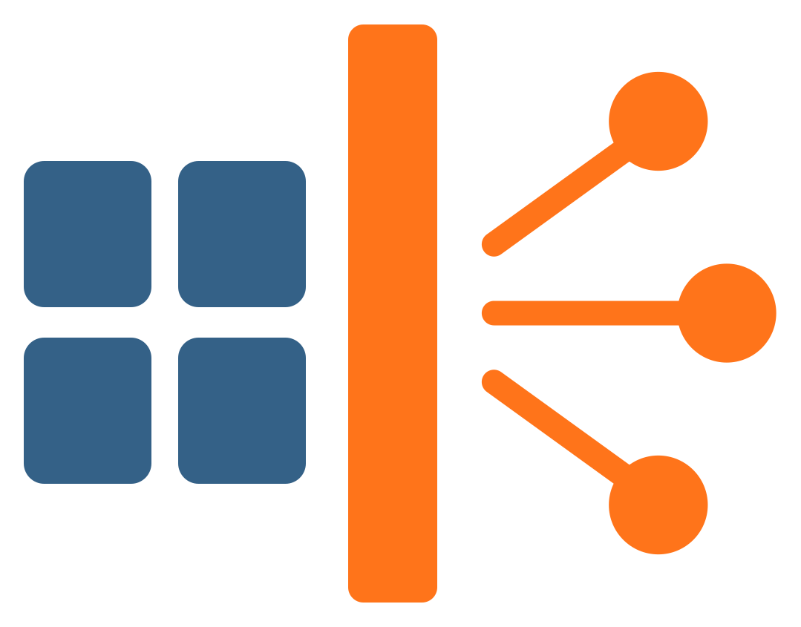

<p align="center">
  
</p>

# oas2mcp

Load an [OpenAPI](https://www.openapis.org/) document at startup and expose
every operation it describes as a tool of a
[Model Context Protocol (MCP)](https://modelcontextprotocol.io/) server.

**Documentation: <https://oas2mcp.therealm.tech/>**
— also for LLMs, at <https://oas2mcp.therealm.tech/llms.txt>.

## Description

Each OpenAPI operation becomes one MCP tool: calling it sends the matching HTTP
request to the upstream API, so an agent can drive that API without glue code.

It reads OpenAPI 3.0 and 3.1, serves MCP over `stdio`, Streamable HTTP or SSE,
authenticates upstream with static, forwarded or OAuth2 credentials, and gates
tools by the caller's verified JWT. The
[feature list](https://oas2mcp.therealm.tech/#features) has the details.

See [ARCHITECTURE.md](ARCHITECTURE.md) for how it is put together.

## Getting started

### Prerequisites

Docker, to run the published image; or [`rustup`](https://rustup.rs), to build
from source — the toolchain version is pinned in `rust-toolchain.toml` and
installed on the first `cargo` invocation.

### Installation

The image is published on GHCR for `amd64` and `arm64`; its entrypoint is the
`oas2mcp` binary:

```bash
docker run --rm -i ghcr.io/therealm-tech/oas2mcp --openapi-url https://petstore3.swagger.io/api/v3/openapi.json
```

Or build from source:

```bash
git clone https://github.com/therealm-tech/oas2mcp.git
```

```bash
cd oas2mcp
```

```bash
cargo build --release
```

The binary is `target/release/oas2mcp`.

### Configuration

Every option is also an environment variable; the
[configuration reference](https://oas2mcp.therealm.tech/reference/configuration/)
lists them all.

### Usage

Expose the bundled Petstore example over stdio:

```bash
target/release/oas2mcp --openapi-file examples/petstore.yaml
```

Serve a remote API over Streamable HTTP, on `POST http://0.0.0.0:8000/mcp`:

```bash
target/release/oas2mcp http --openapi-url https://api.example.com/openapi.json --bind-addr 0.0.0.0:8000 --header 'Authorization: Bearer <token>'
```

The [documentation](https://oas2mcp.therealm.tech/getting-started/) covers
authentication, filtering, metrics and connecting an MCP client.

### Deployment

A Helm chart lives in [charts/oas2mcp](charts/oas2mcp):

```bash
helm install petstore charts/oas2mcp --set oas2mcp.openapi.url=https://petstore3.swagger.io/api/v3/openapi.json
```

See [Deploying on Kubernetes](https://oas2mcp.therealm.tech/guides/kubernetes/)
and the chart's [README](charts/oas2mcp/README.md) for every value.

## Contributing

See [CONTRIBUTING.md](CONTRIBUTING.md) for the development setup, the tests and
the CI.

## License

Apache-2.0 — see [LICENSE](LICENSE).
